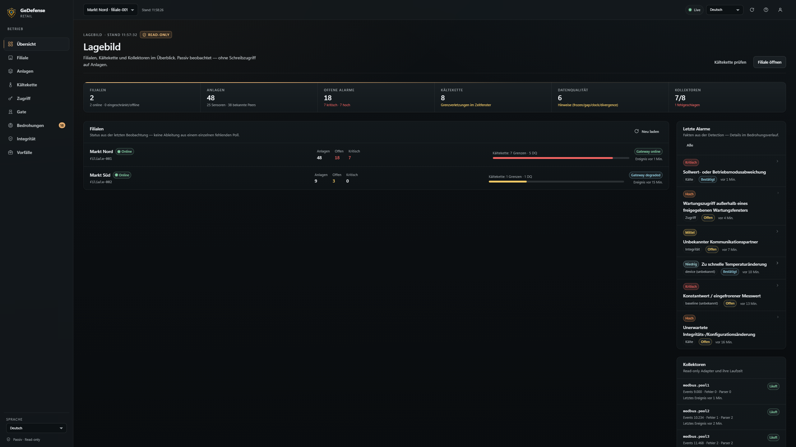
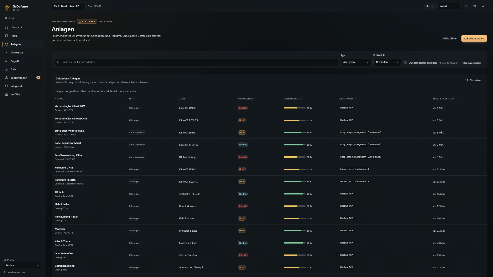
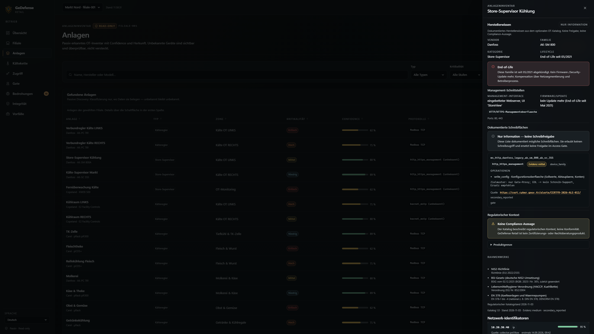
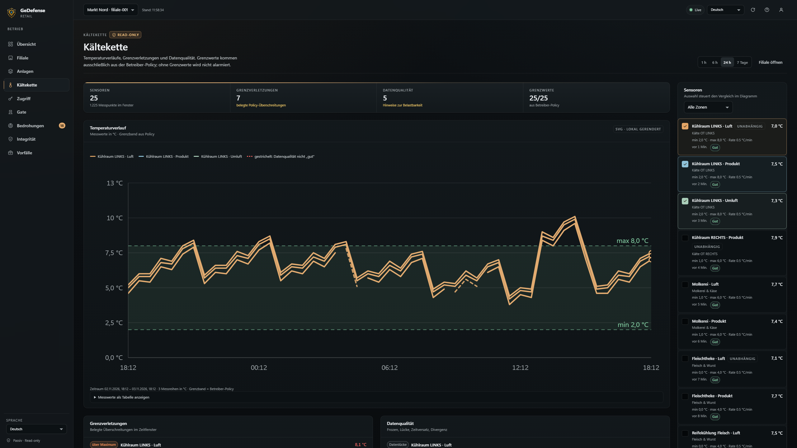
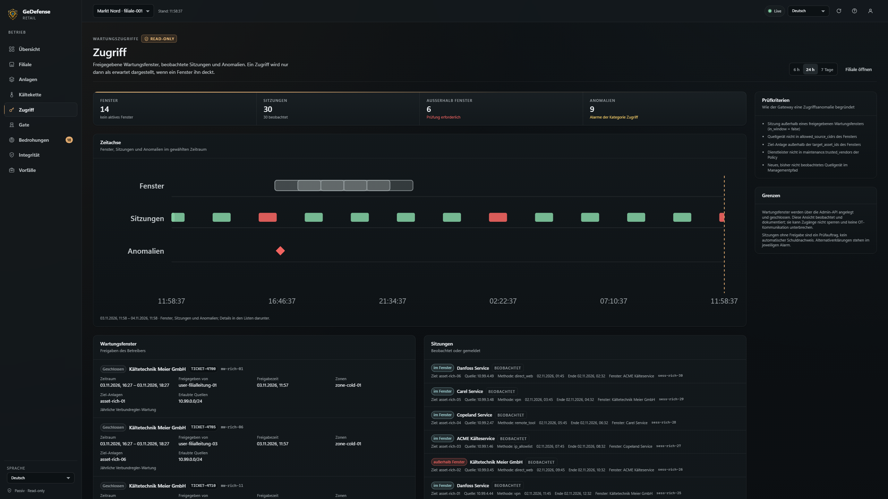
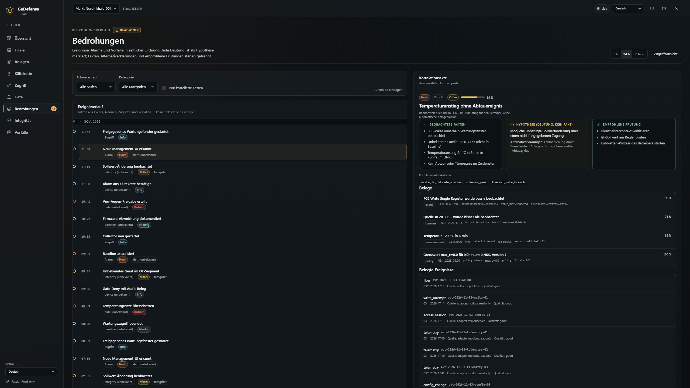
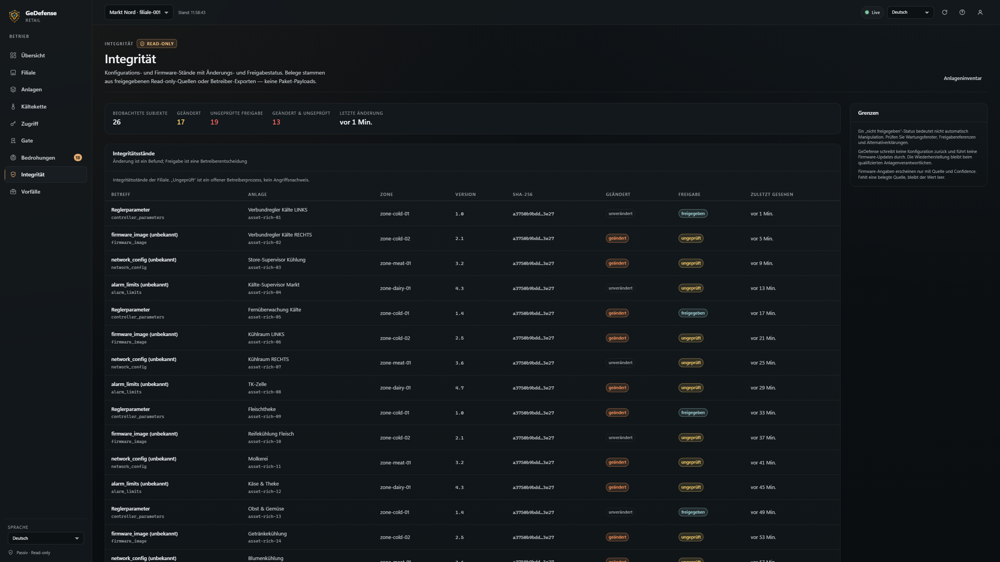
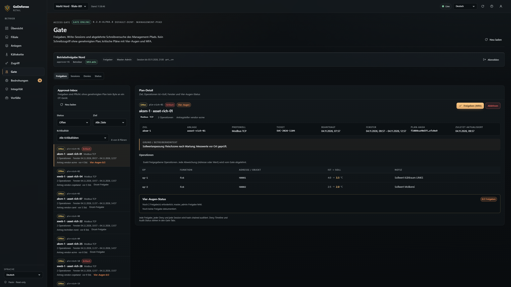
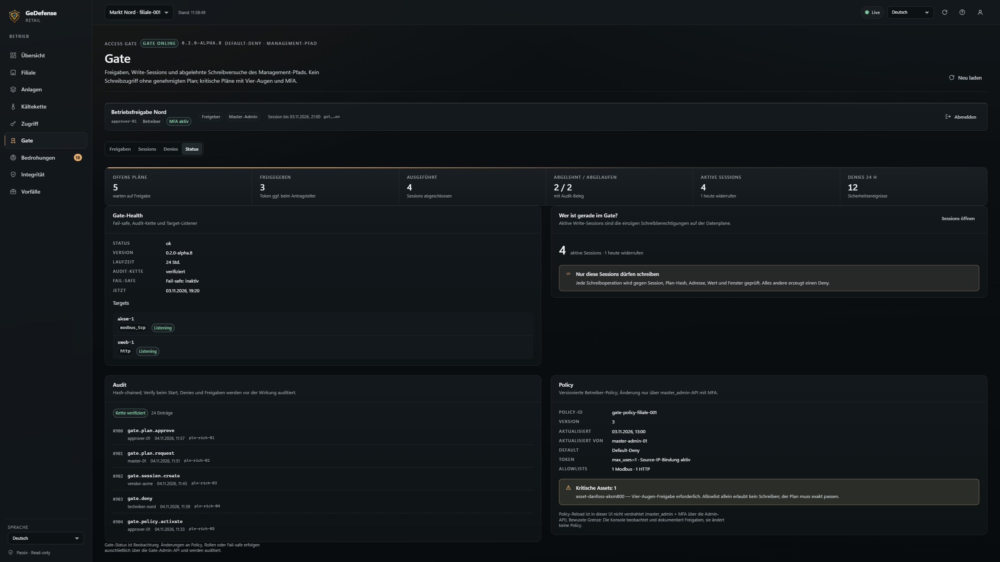
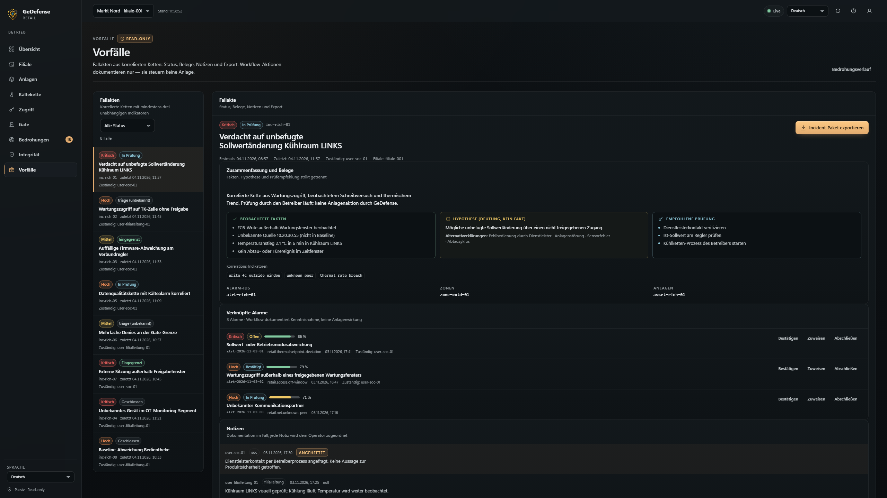

<p align="center">
  <a href="docs/assets/gedefense-logo.png">
    
  </a>
</p>

<h1 align="center">GeDefense Retail</h1>

<p align="center"><strong>ColdChain &amp; Store Infrastructure Security</strong><br>
Monitorización OT pasiva y un gate de aplicación Default-Deny para la ruta de gestión de la tienda.</p>

<p align="center">
  <a href="https://github.com/visiongaiatechnology/gedefense-retail/releases"></a>
  
  
  
  
</p>

[English](README.md) · [Deutsch](README.de.md) · [Français](README.fr.md) · [Italiano](README.it.md) · [Español](README.es.md) · [日本語](README.ja.md) · [中文](README.zh.md) · [Русский](README.ru.md)

---

<a id="alpha-status"></a>
## Estado alfa

> **0.3.0-alpha.1 — experimental, no listo para producción.**
> GeDefense Retail es un alfa temprano. Se ha verificado en loopback con reguladores y supervisores
> simulados, no contra hardware frigorífico real en una tienda. Todavía no existe una prueba de
> penetración independiente del Access Gate y no se formula ninguna declaración de conformidad ni de
> certificación. No lo utilice como único control de seguridad, de seguridad alimentaria o de
> monitorización de una instalación frigorífica.

<a id="overview"></a>
## Qué es

GeDefense Retail protege y documenta la infraestructura que hay detrás de un supermercado:
reguladores de frío, cámaras frigoríficas, muebles refrigerados, pasarelas de sensores, automatización
del edificio y la ruta de mantenimiento remoto que utilizan las empresas de refrigeración.

Se distribuye como dos servicios independientes:

| Servicio | Binario | Función |
|---|---|---|
| **Monitorización** | `retaild` | Observabilidad OT pasiva y de solo lectura: activos, flujos, integridad de la cadena de frío, calidad de los datos, alertas, auditoría, panel |
| **Access Gate** | `retailgate` | La única ruta permitida para escrituras de gestión/configuración hacia los reguladores: Default-Deny, vinculada a un plan, aprobada por una persona, totalmente auditada |
| **Simulador** | `retail-sim` | Datos de prueba locales para desarrollo y campañas de aceptación (solo loopback) |

**Promesa del producto:**

- **Ninguna ruta de escritura hacia el proceso OT desde GeDefense.** `retaild` y todos los adaptadores
  pasivos nunca escriben en un regulador. El Access Gate no controla el proceso; autoriza y reenvía una
  única operación de configuración aprobada explícitamente.
- **Las escrituras son Default-Deny.** Una escritura solo se reenvía si coincide con un *plan de
  escritura* aprobado (destino, protocolo, función, dirección **y** valor) dentro de una ventana
  temporal aprobada.
- **Control humano.** Los activos críticos requieren dos aprobaciones distintas, una de ellas de un
  `master_admin`. No hay escrituras autónomas, ni escrituras programadas, ni decisiones de IA.
- **Fail-closed para la ruta de gestión.** Si el gate se detiene, la gestión remota queda cerrada. La
  instalación frigorífica sigue funcionando de forma autónoma porque el gate no forma parte del bucle
  del proceso.
- **La evidencia antes del efecto.** Cada acción y cada escritura denegada se registran en un log de
  auditoría encadenado por hash; el gate se niega a arrancar si la cadena está rota.

<a id="features"></a>
## Fabricantes y modelos compatibles

El descubrimiento pasivo y el asesoramiento cubren el panorama OT de supermercados DE/EU siguiente. **Documentado** significa que el fabricante/modelo y la interfaz de gestión están verificados en el catálogo OT; **solo catálogo** significa que el fabricante figura sin detalles verificados de la interfaz; **solo componente** significa que no se asume una pila IP propia. GeDefense nunca aprueba escrituras automáticamente: el Access Gate solo reenvía operaciones exactas aprobadas por el operador.

| Fabricante | Modelos / familias | Integración |
|---|---|---|
| Danfoss | AK-SM 800 / 800A, AK-SC 355, AK-PC 781 | documentado |
| Copeland | XWEB 500, E2, E3 Site Supervisor | documentado |
| Dixell (Copeland) | XWEB | documentado |
| Carel | pCO / pCO5+, Compressor Rack / Total Store (pRack / μRack as unverified synonyms), RED/tERA cloud | portafolio documentado; protocolos sin verificar |
| RDM | Intuitive Supervisor | solo catálogo |
| Eliwell | Refrigeration controllers | solo catálogo |
| TEKO | Refrigeration controllers | solo catálogo |
| Bitzer | Compressors (no IP stack) | solo componente |
| GEA | Refrigeration systems | solo componente |
| Günther | Heat exchangers / condensers | solo componente |
| Wurm | Refrigeration systems | solo componente |
| Systemair | Ventilation / HVAC | solo componente |

**Protocolos:** Modbus TCP, BACnet/IP, MQTT, SNMPv3 e interfaces de gestión HTTP(S) están implementados para descubrimiento pasivo. BACnet MSTP y SOAP/XML están documentados para supervisores concretos; LON/buses propietarios no tienen adaptador en esta alfa. La asignación OUI/MAC no se afirma deliberadamente.

## Funcionalidades

### Monitorización ColdChain (`retaild`, pasiva/solo lectura)

- Descubrimiento pasivo de activos a partir de metadatos de flujo, indicios OUI y evidencias de
  protocolo: los dispositivos desconocidos siguen siendo desconocidos, con valores de confianza.
- Observación de la red OT: nuevos interlocutores, rutas inesperadas, metadatos de protocolo, líneas
  base de flujo.
- Integridad de la cadena de frío: límites de temperatura definidos por el operador, velocidad de
  cambio, desviación del valor consigna, divergencia entre sensores independientes.
- Comprobaciones de calidad de datos: valores congelados, lagunas de telemetría, desfase de reloj,
  valores no plausibles: una mala lectura nunca se muestra como una buena temperatura.
- Accesos de mantenimiento: ventanas aprobadas, anomalías en accesos de proveedores, metadatos de
  sesión.
- Reglas de detección e incidentes correlacionados: hechos, hipótesis y comprobaciones recomendadas se
  mantienen separados en cada alerta.
- Funcionamiento local primero: la detección y las alertas siguen funcionando sin WAN; cola local
  acotada para el reenvío posterior.
- Auditoría encadenada por hash, acceso a la API basado en roles, panel de estilo cristal, sin CDN
  externo y sin framework de frontend de terceros.
- Adaptadores pasivos/de solo lectura para Modbus TCP, MQTT, BACnet/IP, SNMP (GET v1/v2c), PCAP y
  metadatos de interfaz de gestión HTTP.

### Access Gate (`retailgate`, aplicación del Default-Deny)

- Planes de escritura con valor actual, valor nuevo, motivo, referencia de ticket (opcional), ventana y
  hash de plan inmutable.
- Flujo de aprobación con MFA (TOTP en este alfa), aprobaciones idempotentes, denegación de la
  autoaprobación y principio de cuatro ojos para activos críticos.
- Token de un solo uso y sesión de escritura vinculada a la IP de origen; los intentos de replay,
  caducidad y origen incorrecto se deniegan y generan alerta.
- Proxy de aplicación Modbus TCP y proxy inverso HTTP(S) para las interfaces web de los supervisores.
- Listas de permitidos de registros y URL; el allowlisting es necesario pero no suficiente: además debe
  coincidir exactamente un plan aprobado.
- Deny timeline, evidencias de denegación y auditoría para cada escritura rechazada.
- Matriz fail-safe: los errores de almacén/auditoría, los saltos de reloj y una política no válida
  cierran la ruta de escritura; un gate caído deja la instalación intacta.
- Notificaciones webhook firmadas con HMAC con escalado y acuse de recibo (`GET /escalations`,
  `POST /escalations/{id}/ack`).

### Novedades de 0.2.0-alpha.2

- **Asistente de configuración** (primer arranque, solo loopback) con pasos guiados para idioma, sitio,
  lista blanca de acceso, cuenta de administrador, colectores y finalización.
- **Lista blanca de IP** aplicada al panel, a la API, al SSE, a los recursos estáticos y al setup una
  vez configurada (`require_whitelist` activado por defecto; fail-closed).
- **Ocho idiomas de interfaz**: inglés, alemán, francés, italiano, español, japonés, chino, ruso.
- **Logotipo original de GeDefense** y mascota integrados como recursos locales (sin CDN externo).
- Paquetes para Linux y Windows con scripts de instalación y sumas de comprobación SHA-256.

**Novedades en 0.3.0-alpha.1:** documentación de proveedor/piloto en `docs/retail/`, relectura de CurrentValue antes de escribir en Modbus (discrepancia/fallo ⇒ denegación + auditoría), catálogo de proveedores en tiempo de ejecución (sin auto-allow) y `data/ot-catalog` en el paquete.

**Novedades en 0.3.0-alpha.1:** monitorización de integridad de consignas con **recuperación automática opt-in** (desactivada por defecto; rate-limit, cooldown, relectura, auditada), `retailgate netpolicy` (nftables/iptables; solo CIDR origen del gate) y detección pasiva de bypass (`retail.bypass-suspected`).

<a id="architecture"></a>
## Arquitectura (resumen)

```text
 Empresa de mantenimiento / operador
 (VPN / ZTNA, en lista blanca)
        │
        ▼
 ┌──────────────────────────────┐        ┌──────────────────────────────┐
 │ retaild (monitorización)     │        │ retailgate (aplicación)      │
 │ TAP/SPAN pasivo, solo lectura│        │ identidad, aprobación, token │
 │ detección, alertas, audit, UI│        │ auditoría, proxies Modbus/HTTP│
 └──────────────┬───────────────┘        └──────────────┬───────────────┘
                │ observación pasiva                     │ solo ruta de gestión
                │ (nunca escribe)                        │ (vinculada al plan, Default-Deny)
                ▼                                        ▼
        Segmento de monitorización OT             Reguladores / supervisores
        (TAP/SPAN, sondeos de solo lectura)       (Modbus TCP, UI de admin HTTP(S))
```

- Una pasarela por tienda; el funcionamiento local no depende de Internet.
- El Access Gate se despliega como **appliance/VM separada con dos interfaces de red**: un lado de
  gestión/proveedor y un conducto de gestión OT. No es un router y no se sitúa en la comunicación del
  proceso entre regulador y actuadores.
- La gestión centralizada opcional es solo saliente (mTLS).

<a id="alpha-limitations"></a>
## Límites honestos del alfa

- **No se ha probado hardware OT real.** La evidencia del data plane proviene de reguladores y
  supervisores simulados en loopback. Los unit ID reales, los flujos de inicio de sesión de los
  fabricantes, los certificados y los estados de firmware son temas del piloto.
- **TOTP no es un factor resistente al phishing.** FIDO2/WebAuthn está previsto para una versión
  posterior; no se reclama resistencia alguna para el factor del alfa.
- **La segmentación es responsabilidad del operador.** Sin un diseño de red real de «ninguna segunda
  ruta», el gate se puede eludir. El servicio de monitorización hace visibles las elusiones, pero no
  puede impedirlas.
- **La detección de elusión es pasiva, no atribución.** `retaild` genera
  `retail.bypass-suspected` (critical) para intentos de escritura pasivos de orígenes fuera de
  `gate_source_cidrs`; prueba el intento/origen, no el autor ni una brecha de segmentación demostrada.
- **El certificate pinning y las listas de permitidos de parámetros** están implementados en el proxy,
  pero todavía no se exponen en el esquema de configuración.
- **`write_unknown` sin relectura automática.** Si la respuesta del regulador es incierta (timeout,
  desconexión), la escritura se marca como `write_unknown` con una alerta crítica; un operador debe
  verificar el valor con una relectura y **no debe reintentar automáticamente**.
- **Las sesiones de API están en memoria.** Un reinicio desconecta a los usuarios; es un comportamiento
  fail-closed intencionado.
- **Sin data plane BACnet/MQTT y sin control de la nube del fabricante/de la HMI local/USB.** Fuera del
  alcance de este alfa; sigue siendo un tema del operador.
- **Ninguna declaración de conformidad.** GeDefense Retail no reclama HACCP, NIS2, IEC 62443 ni ninguna
  otra certificación.
- **Los permisos de Windows difieren de Linux.** El POSIX `0600/0700` no es un mecanismo de control de
  acceso en Windows; utilice una cuenta de servicio dedicada y ACL explícitas. Es una condición beta
  documentada.

**Límites 0.3.0-alpha.1:** la recuperación automática es opt-in y no prueba que nadie escribiera fuera del gate; la ventana read→write (TOCTOU) permanece; las escrituras HTTP no tienen recheck genérico; `netpolicy` solo actúa en el host del gate y exige routing/segmentación correctos.

<a id="download"></a>
## Descarga

**Última release alfa: [v0.3.0-alpha.1](https://github.com/visiongaiatechnology/gedefense-retail/releases/tag/v0.3.0-alpha.1).**
Recursos: cuatro archivos, [SHA256SUMS](https://github.com/visiongaiatechnology/gedefense-retail/releases/download/v0.3.0-alpha.1/SHA256SUMS),
[SHA256SUMS.archives](https://github.com/visiongaiatechnology/gedefense-retail/releases/download/v0.3.0-alpha.1/SHA256SUMS.archives),
[SBOM.spdx.json](https://github.com/visiongaiatechnology/gedefense-retail/releases/download/v0.3.0-alpha.1/SBOM.spdx.json)
y firmas cosign (`*.sig`/`*.pem`). Los binarios de Windows son **NOT_SIGNED** (Authenticode, alfa);
use los hashes/firmas.

| Plataforma | Archivo | Sumas de control |
|---|---|---|
| Linux amd64 | [gedefense-retail-0.3.0-alpha.1-linux-amd64.tar.gz](https://github.com/visiongaiatechnology/gedefense-retail/releases/download/v0.3.0-alpha.1/gedefense-retail-0.3.0-alpha.1-linux-amd64.tar.gz) | [SHA256SUMS](https://github.com/visiongaiatechnology/gedefense-retail/releases/download/v0.3.0-alpha.1/SHA256SUMS) · [archivos](https://github.com/visiongaiatechnology/gedefense-retail/releases/download/v0.3.0-alpha.1/SHA256SUMS.archives) |
| Linux arm64 | [gedefense-retail-0.3.0-alpha.1-linux-arm64.tar.gz](https://github.com/visiongaiatechnology/gedefense-retail/releases/download/v0.3.0-alpha.1/gedefense-retail-0.3.0-alpha.1-linux-arm64.tar.gz) | [SHA256SUMS](https://github.com/visiongaiatechnology/gedefense-retail/releases/download/v0.3.0-alpha.1/SHA256SUMS) · [archivos](https://github.com/visiongaiatechnology/gedefense-retail/releases/download/v0.3.0-alpha.1/SHA256SUMS.archives) |
| Windows amd64 | [gedefense-retail-0.3.0-alpha.1-windows-amd64.zip](https://github.com/visiongaiatechnology/gedefense-retail/releases/download/v0.3.0-alpha.1/gedefense-retail-0.3.0-alpha.1-windows-amd64.zip) | [SHA256SUMS](https://github.com/visiongaiatechnology/gedefense-retail/releases/download/v0.3.0-alpha.1/SHA256SUMS) · [archivos](https://github.com/visiongaiatechnology/gedefense-retail/releases/download/v0.3.0-alpha.1/SHA256SUMS.archives) |
| Windows arm64 | [gedefense-retail-0.3.0-alpha.1-windows-arm64.zip](https://github.com/visiongaiatechnology/gedefense-retail/releases/download/v0.3.0-alpha.1/gedefense-retail-0.3.0-alpha.1-windows-arm64.zip) | [SHA256SUMS](https://github.com/visiongaiatechnology/gedefense-retail/releases/download/v0.3.0-alpha.1/SHA256SUMS) · [archivos](https://github.com/visiongaiatechnology/gedefense-retail/releases/download/v0.3.0-alpha.1/SHA256SUMS.archives) |

**Verifique antes de instalar:** `sha256sum -c SHA256SUMS` dentro del paquete descomprimido y
`sha256sum -c SHA256SUMS.archives` para los archivos descargados. Los archivos y `SHA256SUMS` están
firmados con cosign keyless; verifique un archivo con `cosign verify-blob --certificate <archivo>.pem
--signature <archivo>.sig --certificate-oidc-issuer https://token.actions.githubusercontent.com
--certificate-identity-regexp 'https://github.com/visiongaiatechnology/gedefense-retail/.github/workflows/release.yml@refs/tags/v.*' <archivo>` (identidad exacta en
[docs/BUILD-AND-RELEASE.md](docs/BUILD-AND-RELEASE.md)). `SBOM.spdx.json` es el SBOM SPDX de los archivos y binarios de la release; todos los archivos del paquete están cubiertos por el `SHA256SUMS` del paquete.
**Si falta un archivo de firma, trate la descarga como no firmada.**

Cada paquete contiene `bin/` (binarios), `config/` (configuración de ejemplo y unidades de systemd),
`docs/`, `README.md`, `LICENSE`, `VERSION`, `THIRD-PARTY-NOTICES.md`, los scripts de instalación y un
archivo `SHA256SUMS`.

<a id="install-linux"></a>
## Capturas de pantalla (2K, datos de demostración)

Capturadas con la demo local y datos realistas de supermercado — **sin datos de producción**. Todas las imágenes son **2560 × 1440 px**.

<table>
  <tr>
    <td></td>
    <td></td>
  </tr>
  <tr>
    <td></td>
    <td></td>
  </tr>
  <tr>
    <td></td>
    <td></td>
  </tr>
  <tr>
    <td></td>
    <td></td>
  </tr>
  <tr>
    <td></td>
    <td></td>
  </tr>
</table>

## Instalación — Linux

**Requisitos previos**

- Linux x86-64 o arm64 con systemd.
- Derechos de administrador para la instalación.
- Un cliente de gestión dentro del CIDR de la lista blanca prevista (loopback durante el setup).
- No se necesita toolchain de Go para los paquetes binarios.
- Planifique la lista blanca y la segmentación OT/gestión **antes** de activar el acceso remoto.

**1. Descargar y verificar**

```bash
tar -xzf gedefense-retail-<version>-linux-amd64.tar.gz
cd gedefense-retail-<version>-linux-amd64
sha256sum -c SHA256SUMS
```

**2. Instalar**

```bash
sudo ./install.sh
```

El instalador crea las cuentas de servicio, instala las unidades de systemd desde `config/`
(`gedefense-retail.service`, `gedefense-retailgate.service`), prepara `/etc/gedefense-retail/`,
`/var/lib/gedefense-retail/`, `/var/lib/gedefense-gate/` y `/var/log/gedefense-retail/`, y deja el
servicio de monitorización listo para el setup de primer arranque. Solo copia la **configuración de
ejemplo** (`retail.example.json`, `gate.example.json`, `gate-policy.example.json`) y nunca sobrescribe
archivos existentes. La configuración se instala `root:gedefense` (directorios `0750`, archivos
`0640`), los directorios de datos pertenecen a las cuentas de servicio y el instalador se detiene si
fallan estos pasos de permisos (fail-closed). El operador crea la configuración productiva a partir
de los ejemplos:

```bash
sudo cp /etc/gedefense-retail/retail.example.json /etc/gedefense-retail/retail.json
# editar retail.json: sede, usuarios, colectores, lista blanca de seguridad, destinos/upstreams del gate
```

**3. Setup de primer arranque (solo loopback)**

```bash
sudo systemctl enable --now gedefense-retail
```

Con `setup.completed=false`, el primer arranque se enlaza **solo a loopback** (configure `listen` como
`127.0.0.1:8080` para la URL siguiente). Abra `http://127.0.0.1:8080/setup` en la propia pasarela
(túnel SSH o navegador local) y complete el asistente: idioma, sede/zona horaria, lista blanca de acceso
(por ejemplo `127.0.0.1/32`, `::1/128` más su CIDR de gestión), token de admin (mostrado **una sola
vez**), colectores opcionales, finalización (`restart_required: true`). `security.setup_token_ttl_s`
vale 3600 segundos por defecto. La lista blanca es fail-closed: sin entrada, los clientes que no son de
loopback reciben `403 ip_not_allowed` y no se expone ninguna página de inicio de sesión.

```bash
sudo systemctl restart gedefense-retail
```

**4. Verificar**

```bash
systemctl status gedefense-retail --no-pager
retaild version
curl -s http://127.0.0.1:8080/api/v1/health
```

Solo las IP de origen dentro de `security.dashboard_whitelist_cidrs` pueden alcanzar el panel, la API,
el SSE y los recursos estáticos. Una petición procedente del exterior de la lista blanca recibe
`403 ip_not_allowed`; no existe ninguna página de inicio de sesión de respaldo.

**5. Opcional: activar el Access Gate**

Active el gate solo después de completar la configuración de la monitorización. Requiere **tanto**
`gate.json` como `gate-policy.json`; sin una configuración y una política válidas se niega a arrancar
(fail-closed).

```bash
sudo cp /etc/gedefense-retail/gate.example.json /etc/gedefense-retail/gate.json
sudo cp /etc/gedefense-retail/gate-policy.example.json /etc/gedefense-retail/gate-policy.json
# editar ambos archivos: destinos, usuarios, lista blanca, activos críticos, listas de permitidos
sudo retailgate hash-password --password "<at least 12 characters>"
sudo retailgate gen-totp
# insertar el hash de contraseña y el secreto TOTP impresos en gate.json, luego validar e iniciar:
sudo -u gedefense-gate retailgate check --config /etc/gedefense-retail/gate.json
sudo systemctl enable --now gedefense-retailgate
```

El gate debe ejecutarse en la appliance/VM separada de dos NIC (lado de gestión y conducto de gestión
OT), no en el host de monitorización. Sin una segmentación correcta, el gate se puede eludir.

<a id="install-windows"></a>
## Instalación — Windows

**Requisitos previos**

- Windows 10/11 o Windows Server 2019+ (x64 o arm64), PowerShell 5.1+.
- Derechos de administrador.
- Un cliente de gestión dentro del CIDR de la lista blanca prevista; el setup se ejecuta solo por
  loopback.

**1. Descargar, extraer, verificar**

```powershell
Expand-Archive .\gedefense-retail-<version>-windows-amd64.zip -DestinationPath .
cd .\gedefense-retail-<version>-windows-amd64
Get-FileHash .\bin\retaild.exe -Algorithm SHA256
# comparar con los valores de SHA256SUMS (todos los archivos del paquete)
```

**2. Instalar**

```powershell
# PowerShell con derechos de administrador
.\install-windows.ps1
```

El instalador crea el directorio del programa `C:\Program Files\GeDefense\Retail\` (con `bin\` y
`config\`), el directorio de datos `C:\ProgramData\GeDefense\Retail\`, y registra los servicios de
Windows mediante `sc.exe` (`gedefense-retail`, `gedefense-retailgate`). Solo copia la **configuración de
ejemplo**; el operador crea los archivos productivos `retail.json` / `gate.json` a partir de los
ejemplos en `config\`. **Las reglas de firewall no se crean automáticamente**: añada solo los puertos
de lista blanca y de gestión que realmente necesite.

**3. Setup de primer arranque**

```powershell
Start-Service gedefense-retail
```

Abra `http://127.0.0.1:8080/setup` en la pasarela (con `listen` configurado como `127.0.0.1:8080`),
complete los seis pasos del setup y reinicie:

```powershell
Restart-Service gedefense-retail
Get-Service gedefense-retail
.\bin\retaild.exe version
```

**Permisos de Windows (alfa):** el instalador ejecuta ambos servicios como
`NT AUTHORITY\LocalService` y aplica ACL `icacls` explícitas sin herencia: `config\` en lectura,
`C:\ProgramData\GeDefense\Retail\` en modificación para el servicio, Administradores control total,
`Users` sin acceso. Los modos POSIX no protegen NTFS; no reactive las ACL heredadas. La
desinstalación no restaura las ACL anteriores.

**4. Opcional: Access Gate**

```powershell
# ejemplos de configuración: C:\Program Files\GeDefense\Retail\config\gate.example.json / gate-policy.example.json
# archivos productivos: ...\config\gate.json y ...\config\gate-policy.json (editar destinos/usuarios/listas de permitidos)
.\bin\retailgate.exe hash-password --password "<at least 12 characters>"
.\bin\retailgate.exe gen-totp
# insertar el hash de contraseña y el secreto TOTP impresos en gate.json, luego validar e iniciar:
.\bin\retailgate.exe check --config "C:\Program Files\GeDefense\Retail\config\gate.json"
Start-Service gedefense-retailgate
```

El gate requiere ambos archivos de configuración y se niega a arrancar sin una política válida
(fail-closed). Ejecútelo en una appliance/VM separada de dos NIC; el instalador de Windows no configura
ni la segmentación ni las reglas de firewall.

<a id="quickstart"></a>
## Inicio rápido

1. Instale el paquete de su plataforma.
2. Inicie el servicio de monitorización y complete el asistente de setup en loopback.
3. Añada al menos un CIDR de cliente de gestión a la lista blanca; de lo contrario, toda petición que
   no sea de loopback se deniega.
4. Inicie sesión en el panel con el token de admin que el asistente muestra una sola vez.
5. Para simulación o desarrollo, ejecute `retail-sim` en la pasarela (solo loopback, se requiere el flag
   de simulación); nunca contra dispositivos OT de producción.

Desde el código fuente (desarrolladores, Go 1.23+, solo biblioteca estándar, sin CGO):

```bash
go build ./...
go vet ./...
go test ./...
```

<a id="security"></a>
## Modelo de seguridad

- **Monitorización de solo lectura.** `retaild` no tiene ninguna ruta de escritura OT. Los adaptadores
  pasivos nunca envían códigos de función de escritura, nunca realizan escaneos activos y nunca envían
  sondas en bruto.
- **Ruta de gestión Default-Deny.** `retailgate` solo reenvía las operaciones que coinciden exactamente
  con un plan aprobado; todo lo demás se deniega, se audita y se alerta.
- **Vinculación exacta.** El destino, el protocolo, la función, la dirección y el valor se aprueban como
  una unidad. Un valor o una dirección distintos constituyen una denegación incluso dentro de la ventana
  temporal aprobada.
- **Aprobación humana.** La autoaprobación se rechaza; los activos críticos requieren dos aprobadores
  distintos, incluido un `master_admin`. El token de un solo uso se muestra una sola vez y está
  vinculado al hash del plan y a la IP de origen.
- **Auditoría antes del efecto.** Las operaciones denegadas y permitidas se registran en un log de
  auditoría encadenado por hash; el gate se niega a arrancar si la cadena está rota.
- **Fail-closed.** Los problemas de gate, almacén, reloj o política cierran la ruta de gestión; la
  instalación sigue funcionando.
- **Red.** La aplicación de la lista blanca es fail-closed. No exponga el panel ni el gate a Internet;
  utilice una ruta VPN/ZTNA y ajustes de proxy documentados si necesita acceso remoto.
- **Notificación.** Notifique las vulnerabilidades de forma confidencial tal como se describe en
  [SECURITY.md](SECURITY.md). No realice pruebas contra equipos frigoríficos de producción.
- **Ninguna declaración de conformidad.** Consulte [SECURITY.md](SECURITY.md) y [NOTICE](NOTICE).

<a id="evidence"></a>
## Estado de verificación (honesto)

| Área | Estado |
|---|---|
| Build, vet, pruebas unitarias/de integración, detector de carreras | verde (loopback/CI) |
| Aceptación de extremo a extremo 0.1 (monitorización) | 39/39 comprobaciones superadas (loopback/simulación) |
| Extremo a extremo del Access Gate 0.2.0-alpha.1 | 25/25 comprobaciones superadas (loopback, reguladores simulados) |
| Design QA | capturas de pantalla con datos simulados generadas; sin validación de lector de pantalla/táctil/larga duración |
| Hardware OT real | aún no probado (tema del piloto) |
| Prueba de penetración independiente del gate | aún no disponible |
| Conformidad/certificación | ninguna reclamada |

Las cifras se refieren a las campañas de verificación descritas en las notas de la versión; no
constituyen una declaración de madurez para producción.

<a id="documentation"></a>
## Documentación

- [README (English)](README.md) · [README (Deutsch)](README.de.md)
- [SECURITY.md](SECURITY.md) — notificación, estado alfa, alcance
- [CONTRIBUTING.md](CONTRIBUTING.md) — build, pruebas, invariantes de seguridad, pull requests
- [CHANGELOG.md](CHANGELOG.md) — historial de versiones
- [THIRD-PARTY-NOTICES.md](THIRD-PARTY-NOTICES.md) — dependencias y recursos
- [NOTICE](NOTICE) — aviso de copyright y licencia
- [LICENSE](LICENSE) — GNU Affero General Public License v3.0
- [Índice de documentación](docs/README.md)
- [Releases](https://github.com/visiongaiatechnology/gedefense-retail/releases) ·
  [Issues](https://github.com/visiongaiatechnology/gedefense-retail/issues)

<a id="license"></a>
## Licencia

GeDefense Retail se distribuye bajo la **GNU Affero General Public License v3.0** (AGPL-3.0).
Consulte [LICENSE](LICENSE) y [NOTICE](NOTICE).

Copyright © 2026 VisionGaiaTechnology.
