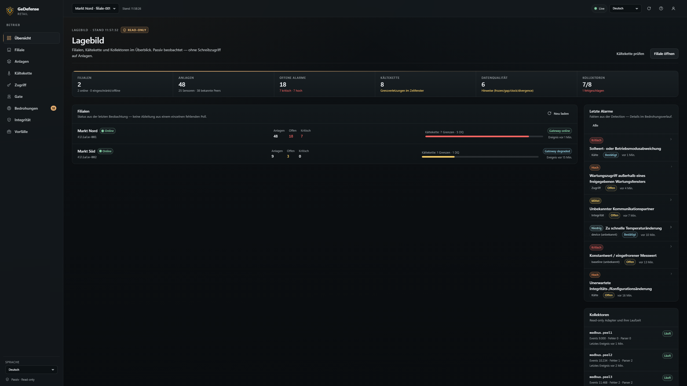
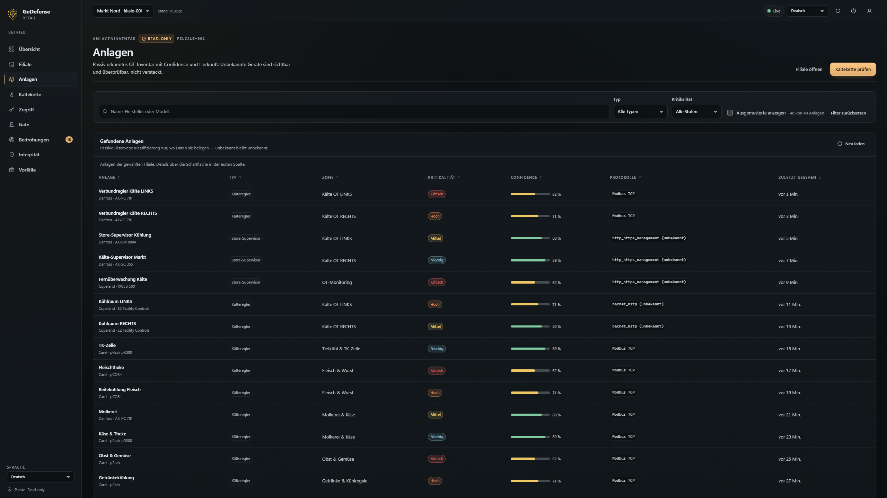
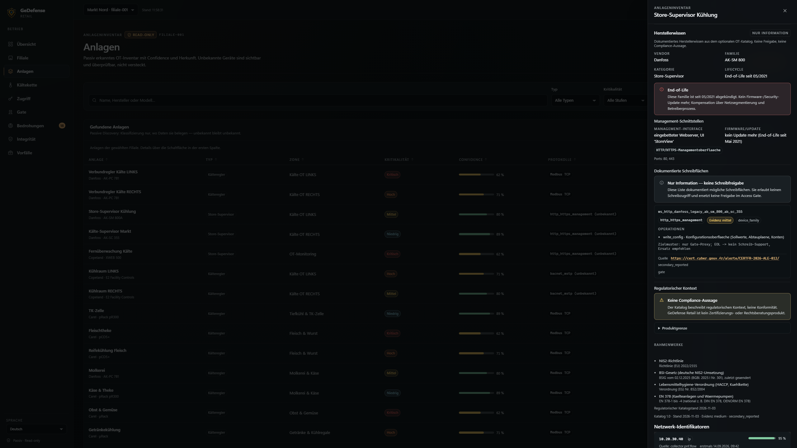
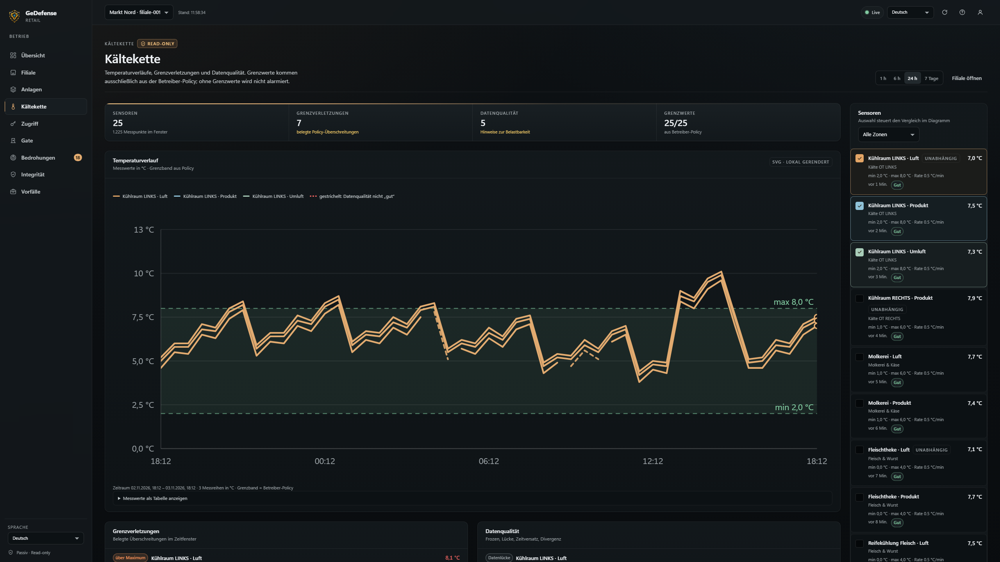
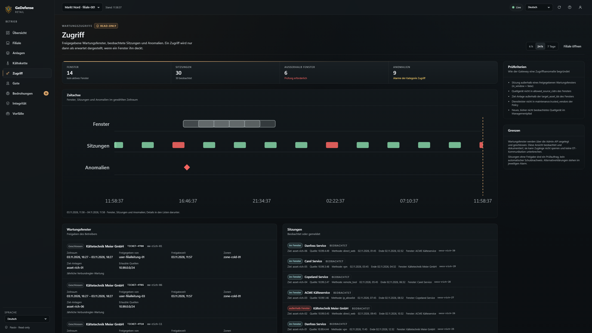
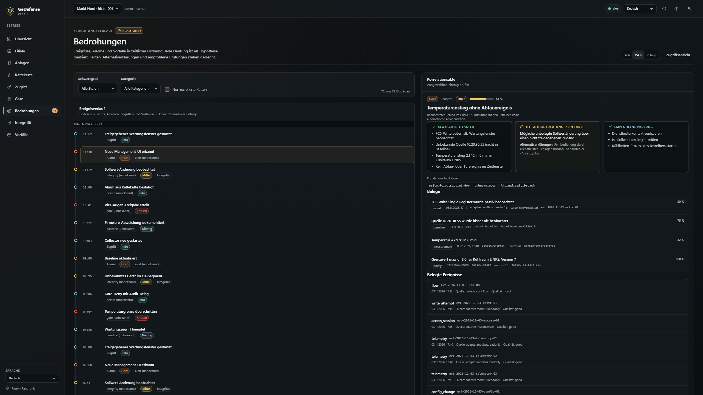
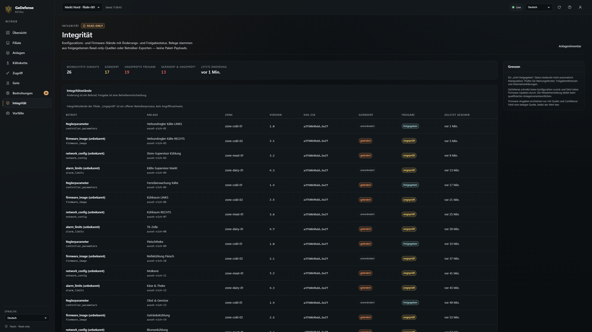
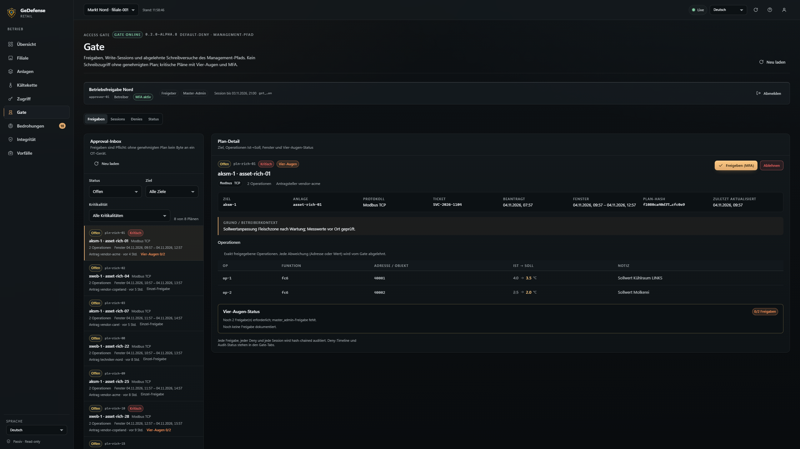
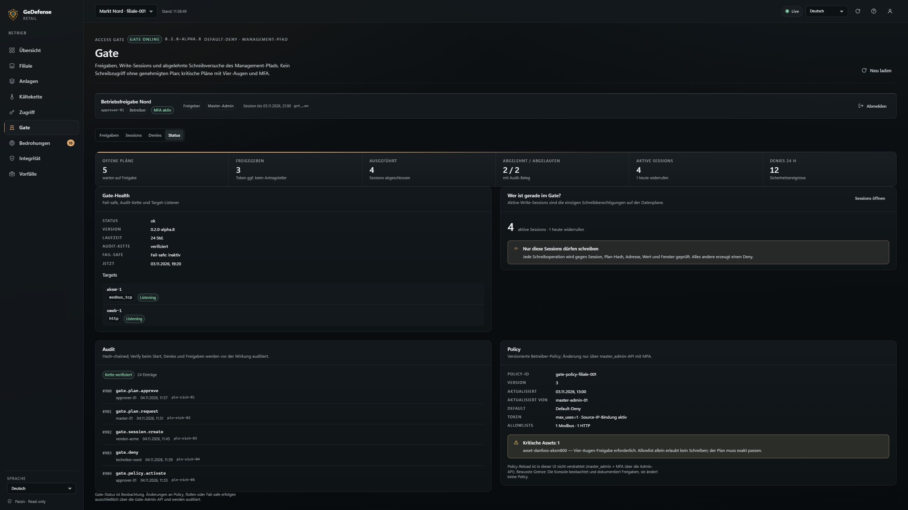
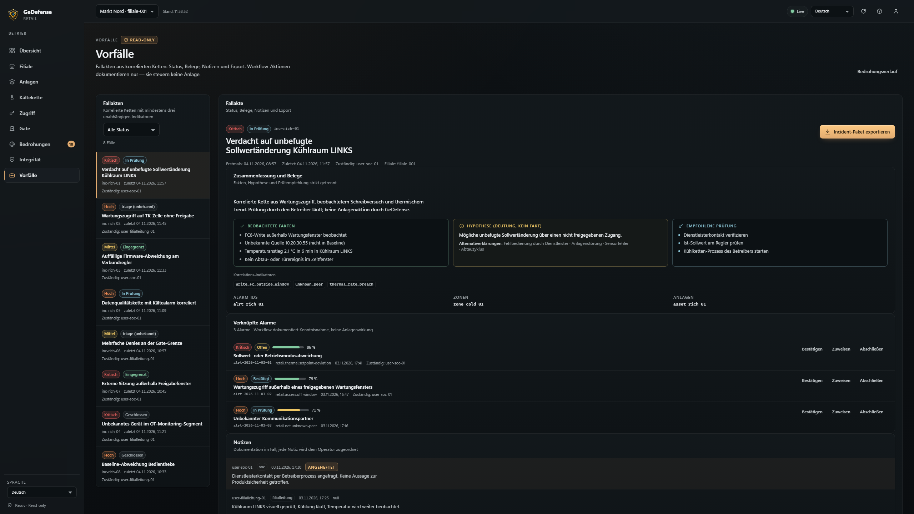

<p align="center">
  <a href="docs/assets/gedefense-logo.png">
    
  </a>
</p>

<h1 align="center">GeDefense Retail</h1>

<p align="center"><strong>ColdChain &amp; Store Infrastructure Security</strong><br>
店舗の管理経路のためのパッシブな OT モニタリングと Default-Deny を適用するゲート。</p>

<p align="center">
  <a href="https://github.com/visiongaiatechnology/gedefense-retail/releases"></a>
  
  
  
  
</p>

[English](README.md) · [Deutsch](README.de.md) · [Français](README.fr.md) · [Italiano](README.it.md) · [Español](README.es.md) · [日本語](README.ja.md) · [中文](README.zh.md) · [Русский](README.ru.md)

---

<a id="alpha-status"></a>
## アルファ版の状態

> **0.2.0-alpha.8 — 実験的な段階であり、本番環境には適していません。**
> GeDefense Retail は初期のアルファ版です。店舗の実際の冷凍機器ではなく、ループバック上で
> シミュレーションされたコントローラーとスーパーバイザーに対して検証されています。Access Gate
> の独立したペネトレーションテストはまだ存在せず、コンプライアンスや認証に関する主張は行っていません。
> 冷凍設備の唯一の安全、食品安全、監視の制御として使用しないでください。

<a id="overview"></a>
## これは何か

GeDefense Retail は、スーパーマーケットの背後にあるインフラを保護し、記録します。対象は冷凍
コントローラー、冷蔵室、冷蔵ショーケース、センサーゲートウェイ、ビルオートメーション、そして
冷凍サービス会社が使用するリモートメンテナンス経路です。

2 つの独立したサービスとして提供されます。

| サービス | バイナリ | 役割 |
|---|---|---|
| **モニタリング** | `retaild` | パッシブで読み取り専用の OT 可観測性: アセット、フロー、コールドチェーンの整合性、データ品質、アラート、監査、ダッシュボード |
| **Access Gate** | `retailgate` | コントローラーへの管理/設定書き込みに対する唯一の許可経路: Default-Deny、プランに紐付け、人による承認、完全な監査 |
| **シミュレーター** | `retail-sim` | 開発と受け入れテスト用のローカルテストデータ (ループバックのみ) |

**製品の約束:**

- **GeDefense からの OT プロセス書き込み経路はありません。** `retaild` とすべてのパッシブアダプターは
  コントローラーに書き込みません。Access Gate はプロセスを制御せず、明示的に承認された単一の設定
  操作を認可して転送するだけです。
- **書き込みは Default-Deny です。** 書き込みは、承認された *Write-Plan* (対象、プロトコル、機能、
  アドレス**および**値) に一致し、承認された時間枠内にある場合にのみ転送されます。
- **人による制御。** 重要なアセットには 2 つの異なる承認が必要で、そのうち 1 つは `master_admin` に
  よるものです。自律的な書き込み、スケジュールベースの書き込み、AI による判断はありません。
- **管理経路は Fail-closed です。** ゲートが停止すると、リモート管理は閉じられます。ゲートは
  プロセスのループに含まれないため、冷凍設備は自律的に稼働し続けます。
- **効果の前に証拠。** すべてのアクションと拒否された書き込みはハッシュチェーン監査ログに記録され、
  チェーンが壊れている場合、ゲートは起動を拒否します。

<a id="features"></a>
## 対応メーカーとモデル

パッシブ検出とアドバイザリは、以下の DE/EU スーパーマーケット OT 環境を対象とします。**文書化済み**は、ベンダー/モデルと管理インターフェースが OT カタログで検証済みであることを意味します。**カタログのみ**は、管理インターフェースの詳細が未検証のまま掲載されていることを意味します。**コンポーネントのみ**は、独自 IP スタックを想定しないことを意味します。GeDefense は書き込みを自動承認しません。Access Gate は、オペレーターが承認した正確な操作のみを転送します。

| メーカー | モデル / ファミリー | 統合 |
|---|---|---|
| Danfoss | AK-SM 800 / 800A, AK-SC 355, AK-PC 781 | 文書化済み |
| Copeland | XWEB 500, E2, E3 Site Supervisor | 文書化済み |
| Dixell (Copeland) | XWEB | 文書化済み |
| Carel | pCO / pCO5+, Compressor Rack / Total Store (pRack / μRack as unverified synonyms), RED/tERA cloud | ポートフォリオは文書化済み、プロトコルは未検証 |
| RDM | Intuitive Supervisor | カタログのみ |
| Eliwell | Refrigeration controllers | カタログのみ |
| TEKO | Refrigeration controllers | カタログのみ |
| Bitzer | Compressors (no IP stack) | コンポーネントのみ |
| GEA | Refrigeration systems | コンポーネントのみ |
| Günther | Heat exchangers / condensers | コンポーネントのみ |
| Wurm | Refrigeration systems | コンポーネントのみ |
| Systemair | Ventilation / HVAC | コンポーネントのみ |

**プロトコル:** Modbus TCP、BACnet/IP、MQTT、SNMPv3、HTTP(S) 管理インターフェースはパッシブ検出用に実装済みです。BACnet MSTP と SOAP/XML は特定のスーパーバイザ向けに文書化されています。LON/独自フィールドバスはこのアルファ版ではアダプターがありません。OUI/MAC によるベンダー判定は意図的に主張していません。

## 機能

### ColdChain モニタリング (`retaild`、パッシブ/読み取り専用)

- フローメタデータ、OUI の手がかり、プロトコルの証拠に基づくパッシブなアセット検出 — 不明な
  デバイスは信頼度の値とともに不明なまま残ります。
- OT ネットワークの観測: 新しい通信相手、予期しない経路、プロトコルメタデータ、フローのベースライン。
- コールドチェーンの整合性: 運用者が定義する温度上限、変化率、設定値からの逸脱、独立した
  センサー間の不一致。
- データ品質チェック: 固定された値、テレメトリの欠落、クロックスキュー、不自然な値 — 悪い測定値が
  良好な温度として表示されることはありません。
- メンテナンスアクセス: 承認された時間枠、ベンダーアクセスの異常、セッションメタデータ。
- 検出ルールと相関インシデント: 事実、仮説、推奨される確認はすべてのアラートで分離して表示されます。
- ローカルファースト: 検出とアラートは WAN なしでも機能し続けます。後で転送するための限られた
  ローカルスプールを備えます。
- ハッシュチェーン監査、ロールベースの API アクセス、グラススタイルのダッシュボード、外部 CDN なし、
  サードパーティのフロントエンドフレームワークなし。
- Modbus TCP、MQTT、BACnet/IP、SNMP (v1/v2c GET)、PCAP、HTTP 管理 UI メタデータ用のパッシブ/
  読み取り専用アダプター。

### Access Gate (`retailgate`、Default-Deny の適用)

- 現在値、新しい値、理由、チケット参照 (任意)、時間枠、不変のプランハッシュを含む Write-Plan。
- MFA (このアルファ版では TOTP)、冪等な承認、自己承認の拒否、重要なアセットに対する四眼の原則を
  備えた承認ワークフロー。
- 単回使用トークンと送信元 IP に紐付けられた書き込みセッション。リプレイ、期限切れ、誤った送信元
  からの試行は拒否され、アラートが発生します。
- Modbus TCP 適用プロキシと、スーパーバイザーの Web UI 用 HTTP(S) リバースプロキシ。
- レジスタと URL の許可リスト。許可リストは必要ですが十分ではありません — 承認されたプランも
  正確に一致する必要があります。
- 拒否されたすべての書き込みに対する Deny タイムライン、拒否の証拠、監査。
- Fail-safe マトリクス: ストア/監査のエラー、時計のジャンプ、無効なポリシーは書き込み経路を閉じます。
  ゲートが停止しても設備は影響を受けません。
- HMAC 署名付き Webhook 通知。エスカレーションと確認応答を備えます (`GET /escalations`、
  `POST /escalations/{id}/ack`)。

### 0.2.0-alpha.2 の新機能

- **セットアップウィザード** (初回起動時、ループバックのみ)。言語、サイト、アクセス許可リスト、
  管理者アカウント、コレクター、完了のためのガイド付きステップを提供します。
- **IP 許可リスト** をダッシュボード、API、SSE、静的アセット、設定後のセットアップに適用
  (`require_whitelist` はデフォルトで有効、fail-closed)。
- **8 つの UI 言語**: 英語、ドイツ語、フランス語、イタリア語、スペイン語、日本語、中国語、ロシア語。
- **オリジナルの GeDefense ロゴ** とマスコットをローカルアセットとして統合 (外部 CDN なし)。
- インストーラースクリプトと SHA-256 チェックサムを含む Linux および Windows パッケージ。

**0.2.0-alpha.8 の新機能:** `docs/retail/` のベンダー/パイロット文書、Modbus 書き込み前の CurrentValue 再読み取り（不一致/読取失敗は拒否＋監査）、実行時ベンダーカタログ（自動許可なし）、パッケージ内 `data/ot-catalog`。

<a id="architecture"></a>
## アーキテクチャ (概要)

```text
 サービス会社 / 運用者
 (VPN / ZTNA、許可リスト済み)
        │
        ▼
 ┌──────────────────────────────┐        ┌──────────────────────────────┐
 │ retaild (モニタリング)        │        │ retailgate (適用)            │
 │ パッシブ TAP/SPAN、読み取り専用│        │ アイデンティティ、承認、トークン│
 │ 検出、アラート、監査、UI      │        │ 監査、Modbus/HTTP プロキシ   │
 └──────────────┬───────────────┘        └──────────────┬───────────────┘
                │ パッシブな観測                          │ 管理経路のみ
                │ (書き込みは行わない)                    │ (プラン紐付け、Default-Deny)
                ▼                                        ▼
        OT モニタリングセグメント                 コントローラー / スーパーバイザー
        (TAP/SPAN、読み取り専用ポーリング)         (Modbus TCP、HTTP(S) 管理 UI)
```

- 店舗ごとに 1 台のゲートウェイ。ローカル運用はインターネットに依存しません。
- Access Gate は **2 つのネットワークインターフェースを持つ別個のアプライアンス/VM** として
  デプロイされます。管理/ベンダー側と OT 管理コンジットです。ルーターではなく、コントローラーと
  アクチュエーター間のプロセス通信には介在しません。
- オプションの集中管理はアウトバウンドのみ (mTLS) です。

<a id="alpha-limitations"></a>
## アルファ版の率直な制限

- **実際の OT ハードウェアは未検証です。** データプレーンの証拠はループバック上のシミュレーション
  されたコントローラーとスーパーバイザーに基づきます。実際のユニット ID、ベンダーのログインフロー、
  証明書、ファームウェアの状態はパイロットの課題です。
- **TOTP はフィッシング耐性のある要素ではありません。** FIDO2/WebAuthn は今後のリリースで計画されて
  おり、アルファ版の要素について耐性を主張しません。
- **セグメンテーションは運用者の責任です。** 実際の「第 2 の経路なし」というネットワーク設計がなければ、
  ゲートは回避可能です。モニタリングサービスは回避を可視化しますが、防止することはできません。
- **自動的なバイパス相関はありません。** ゲートとモニタリングサービスは分離されています。拒否された
  書き込みとパッシブな `retail.write-attempt` アラートは、このアルファ版では手動で相関させます。
- **証明書ピンニングとパラメーター許可リスト** はプロキシに実装されていますが、設定スキーマには
  まだ公開されていません。
- **`write_unknown` に自動読み戻しはありません。** コントローラーの応答が不明確な場合 (タイムアウト、
  切断)、書き込みは `write_unknown` としてマークされ、クリティカルアラートが発生します。運用者は
  読み戻しで値を確認する必要があり、**自動的に再試行してはなりません**。
- **API セッションはメモリ内にあります。** 再起動するとユーザーはログアウトされます。これは意図的な
  fail-closed の動作です。
- **BACnet/MQTT のデータプレーン、ベンダークラウド/ローカル HMI/USB の制御はありません。** この
  アルファ版の範囲外であり、運用者の課題として残ります。
- **コンプライアンスに関する表明はありません。** GeDefense Retail は HACCP、NIS2、IEC 62443、その他の
  認証を主張しません。
- **Windows の権限は Linux と異なります。** POSIX `0600/0700` は Windows ではアクセス制御機構では
  ありません。専用のサービスアカウントと明示的な ACL を使用してください。これは文書化されたベータ
  条件です。

<a id="download"></a>
## ダウンロード

**最新のアルファリリース: [v0.2.0-alpha.8](https://github.com/visiongaiatechnology/gedefense-retail/releases/tag/v0.2.0-alpha.8).**
アセット: 4 つのアーカイブ、[SHA256SUMS](https://github.com/visiongaiatechnology/gedefense-retail/releases/download/v0.2.0-alpha.8/SHA256SUMS)、
[SHA256SUMS.archives](https://github.com/visiongaiatechnology/gedefense-retail/releases/download/v0.2.0-alpha.8/SHA256SUMS.archives)、
[SBOM.spdx.json](https://github.com/visiongaiatechnology/gedefense-retail/releases/download/v0.2.0-alpha.8/SBOM.spdx.json)、
cosign 署名 (`*.sig`/`*.pem`)。Windows バイナリは **NOT_SIGNED** (Authenticode、アルファ) です。ハッシュ/署名を使用してください。

| プラットフォーム | アーカイブ | チェックサム |
|---|---|---|
| Linux amd64 | [gedefense-retail-0.2.0-alpha.8-linux-amd64.tar.gz](https://github.com/visiongaiatechnology/gedefense-retail/releases/download/v0.2.0-alpha.8/gedefense-retail-0.2.0-alpha.8-linux-amd64.tar.gz) | [SHA256SUMS](https://github.com/visiongaiatechnology/gedefense-retail/releases/download/v0.2.0-alpha.8/SHA256SUMS) · [アーカイブ](https://github.com/visiongaiatechnology/gedefense-retail/releases/download/v0.2.0-alpha.8/SHA256SUMS.archives) |
| Linux arm64 | [gedefense-retail-0.2.0-alpha.8-linux-arm64.tar.gz](https://github.com/visiongaiatechnology/gedefense-retail/releases/download/v0.2.0-alpha.8/gedefense-retail-0.2.0-alpha.8-linux-arm64.tar.gz) | [SHA256SUMS](https://github.com/visiongaiatechnology/gedefense-retail/releases/download/v0.2.0-alpha.8/SHA256SUMS) · [アーカイブ](https://github.com/visiongaiatechnology/gedefense-retail/releases/download/v0.2.0-alpha.8/SHA256SUMS.archives) |
| Windows amd64 | [gedefense-retail-0.2.0-alpha.8-windows-amd64.zip](https://github.com/visiongaiatechnology/gedefense-retail/releases/download/v0.2.0-alpha.8/gedefense-retail-0.2.0-alpha.8-windows-amd64.zip) | [SHA256SUMS](https://github.com/visiongaiatechnology/gedefense-retail/releases/download/v0.2.0-alpha.8/SHA256SUMS) · [アーカイブ](https://github.com/visiongaiatechnology/gedefense-retail/releases/download/v0.2.0-alpha.8/SHA256SUMS.archives) |
| Windows arm64 | [gedefense-retail-0.2.0-alpha.8-windows-arm64.zip](https://github.com/visiongaiatechnology/gedefense-retail/releases/download/v0.2.0-alpha.8/gedefense-retail-0.2.0-alpha.8-windows-arm64.zip) | [SHA256SUMS](https://github.com/visiongaiatechnology/gedefense-retail/releases/download/v0.2.0-alpha.8/SHA256SUMS) · [アーカイブ](https://github.com/visiongaiatechnology/gedefense-retail/releases/download/v0.2.0-alpha.8/SHA256SUMS.archives) |

**インストール前に検証:** 展開したバンドルで `sha256sum -c SHA256SUMS`、ダウンロードしたアーカイブに
`sha256sum -c SHA256SUMS.archives`。アーカイブと `SHA256SUMS` は cosign keyless で署名されています。
`cosign verify-blob --certificate <file>.pem --signature <file>.sig
--certificate-oidc-issuer https://token.actions.githubusercontent.com
--certificate-identity-regexp 'https://github.com/visiongaiatechnology/gedefense-retail/.github/workflows/release.yml@refs/tags/v.*' <file>` で検証します (正確な ID は
[docs/BUILD-AND-RELEASE.md](docs/BUILD-AND-RELEASE.md))。`SBOM.spdx.json` は リリースのアーカイブ/バイナリ用 SPDX SBOM (バンドル全ファイルはバンドル内 `SHA256SUMS` でカバー)
インベントリです。**署名ファイルがない場合は未署名として扱ってください。**

各バンドルには `bin/`（バイナリ）、`config/`（設定例と systemd ユニット）、`docs/`、`README.md`、
`LICENSE`、`VERSION`、`THIRD-PARTY-NOTICES.md`、インストーラースクリプト、`SHA256SUMS` が含まれます。

<a id="install-linux"></a>
## スクリーンショット (2K、デモデータ)

ローカルデモと現実的なスーパーマーケットのデータで撮影 — **本番データは含みません**。すべての画像は **2560 × 1440 px** です。

<table>
  <tr>
    <td></td>
    <td></td>
  </tr>
  <tr>
    <td></td>
    <td></td>
  </tr>
  <tr>
    <td></td>
    <td></td>
  </tr>
  <tr>
    <td></td>
    <td></td>
  </tr>
  <tr>
    <td></td>
    <td></td>
  </tr>
</table>

## インストール — Linux

**前提条件**

- systemd を備えた Linux x86-64 または arm64。
- インストールのための管理者権限。
- 予定された許可リスト CIDR 内の管理クライアント (セットアップ中はループバック)。
- バイナリパッケージに Go ツールチェーンは不要です。
- リモートアクセスを有効にする **前に**、許可リストと OT/管理のセグメンテーションを計画してください。

**1. ダウンロードと検証**

```bash
tar -xzf gedefense-retail-<version>-linux-amd64.tar.gz
cd gedefense-retail-<version>-linux-amd64
sha256sum -c SHA256SUMS
```

**2. インストール**

```bash
sudo ./install.sh
```

インストーラーはサービスアカウントを作成し、`config/` から systemd ユニット
(`gedefense-retail.service`、`gedefense-retailgate.service`) をインストールし、
`/etc/gedefense-retail/`、`/var/lib/gedefense-retail/`、`/var/lib/gedefense-gate/`、
`/var/log/gedefense-retail/` を準備して、監視サービスを初回起動セットアップの準備状態にします。
**設定例**（`retail.example.json`、`gate.example.json`、`gate-policy.example.json`）のみをコピーし、
既存のファイルを上書きすることはありません。設定は `root:gedefense`（`0750` ディレクトリ、`0640`
ファイル）でインストールされ、データディレクトリはサービスアカウントが所有します。権限設定に
失敗した場合、インストーラーは中止します（fail-closed）。運用者が例から本番設定を作成します。

```bash
sudo cp /etc/gedefense-retail/retail.example.json /etc/gedefense-retail/retail.json
# retail.json を編集: 拠点、ユーザー、コレクター、セキュリティ許可リスト、ゲートのターゲット/アップストリーム
```

**3. 初回起動セットアップ (ループバックのみ)**

```bash
sudo systemctl enable --now gedefense-retail
```

`setup.completed=false` の場合、初回起動時は**ループバックにのみ**バインドします（下記 URL のために
`listen` を `127.0.0.1:8080` に設定してください）。ゲートウェイ自体で
`http://127.0.0.1:8080/setup` を開き（SSH トンネルまたはローカルブラウザー）、ウィザードを完了します:
言語、拠点/タイムゾーン、アクセス許可リスト（例 `127.0.0.1/32`、`::1/128` と管理 CIDR）、
管理者トークン（**一度だけ**表示）、任意のコレクター、完了（`restart_required: true`）。
`security.setup_token_ttl_s` の既定値は 3600 秒です。許可リストは fail-closed です: エントリがない
場合、非ループバックのクライアントは `403 ip_not_allowed` を受け取り、ログインページは公開されません。

```bash
sudo systemctl restart gedefense-retail
```

**4. 確認**

```bash
systemctl status gedefense-retail --no-pager
retaild version
curl -s http://127.0.0.1:8080/api/v1/health
```

`security.dashboard_whitelist_cidrs` 内の送信元 IP のみがダッシュボード、API、SSE、静的アセットに
アクセスできます。許可リスト外からのリクエストは `403 ip_not_allowed` を受け取ります。フォールバック
のログインページは存在しません。

**5. 任意: Access Gate の有効化**

監視のセットアップが完了してからゲートを有効にしてください。`gate.json` と
`gate-policy.json` の**両方**が必要で、有効な設定とポリシーがない場合は起動を拒否します
(fail-closed)。

```bash
sudo cp /etc/gedefense-retail/gate.example.json /etc/gedefense-retail/gate.json
sudo cp /etc/gedefense-retail/gate-policy.example.json /etc/gedefense-retail/gate-policy.json
# 両方のファイルを編集: ターゲット、ユーザー、許可リスト、重要なアセット、allowlist
sudo retailgate hash-password --password "<at least 12 characters>"
sudo retailgate gen-totp
# 表示されたパスワードハッシュと TOTP シークレットを gate.json に挿入し、検証してから起動:
sudo -u gedefense-gate retailgate check --config /etc/gedefense-retail/gate.json
sudo systemctl enable --now gedefense-retailgate
```

ゲートは、監視ホスト上ではなく、2 つの NIC を持つ別個のアプライアンス/VM（管理側と OT 管理
コンジット）で実行する必要があります。正しいセグメンテーションがなければ、ゲートは回避可能です。

<a id="install-windows"></a>
## インストール — Windows

**前提条件**

- Windows 10/11 または Windows Server 2019+ (x64 または arm64)、PowerShell 5.1+。
- 管理者権限。
- 予定された許可リスト CIDR 内の管理クライアント。セットアップはループバック経由でのみ実行されます。

**1. ダウンロード、展開、検証**

```powershell
Expand-Archive .\gedefense-retail-<version>-windows-amd64.zip -DestinationPath .
cd .\gedefense-retail-<version>-windows-amd64
Get-FileHash .\bin\retaild.exe -Algorithm SHA256
# SHA256SUMS の値（バンドル内のすべてのファイル）と比較する
```

**2. インストール**

```powershell
# 管理者権限の PowerShell
.\install-windows.ps1
```

インストーラーはプログラムディレクトリ `C:\Program Files\GeDefense\Retail\`（`bin\` と `config\` を
含む）、データディレクトリ `C:\ProgramData\GeDefense\Retail\` を作成し、`sc.exe`
（`gedefense-retail`、`gedefense-retailgate`）で Windows サービスを登録します。**設定例**のみを
コピーし、運用者が `config\` 内の例から本番用の `retail.json` / `gate.json` を作成します。
**ファイアウォール規則は自動作成されません** — 実際に必要な許可リストと管理ポートのみを追加して
ください。

**3. 初回起動セットアップ**

```powershell
Start-Service gedefense-retail
```

ゲートウェイで `http://127.0.0.1:8080/setup` を開き（`listen` は `127.0.0.1:8080` に設定）、
6 つのセットアップ手順を完了してから再起動します。

```powershell
Restart-Service gedefense-retail
Get-Service gedefense-retail
.\bin\retaild.exe version
```

**Windows の権限 (アルファ):** インストーラーは両サービスを `NT AUTHORITY\LocalService` として実行し、
継承を無効にした明示的な `icacls` DACL を設定します。`config\` は読み取り、
`C:\ProgramData\GeDefense\Retail\` は変更、Administrators はフル、`Users` はアクセスなし。POSIX モード
は NTFS を保護しません。継承 ACL を再有効化しないでください。アンインストールは以前の ACL を
復元しません。

**4. 任意: Access Gate**

```powershell
# 設定例: C:\Program Files\GeDefense\Retail\config\gate.example.json / gate-policy.example.json
# 本番ファイル: ...\config\gate.json と ...\config\gate-policy.json（ターゲット/ユーザー/allowlist を編集）
.\bin\retailgate.exe hash-password --password "<at least 12 characters>"
.\bin\retailgate.exe gen-totp
# 表示されたパスワードハッシュと TOTP シークレットを gate.json に挿入し、検証してから起動:
.\bin\retailgate.exe check --config "C:\Program Files\GeDefense\Retail\config\gate.json"
Start-Service gedefense-retailgate
```

ゲートは両方の設定ファイルを必要とし、有効なポリシーがない場合は起動を拒否します (fail-closed)。
2 つの NIC を持つ別個のアプライアンス/VM で実行してください。Windows インストーラーはセグメンテーション
もファイアウォール規則も設定しません。

<a id="quickstart"></a>
## クイックスタート

1. お使いのプラットフォーム用のパッケージをインストールします。
2. モニタリングサービスを起動し、ループバックのセットアップウィザードを完了します。
3. 少なくとも 1 つの管理クライアント CIDR を許可リストに追加します。そうしないと、ループバック以外の
   すべてのリクエストが拒否されます。
4. ウィザードが一度だけ表示する管理者トークンでダッシュボードにサインインします。
5. シミュレーションや開発には、ゲートウェイ上で `retail-sim` を実行します (ループバックのみ、
   シミュレーションフラグが必要)。本番の OT デバイスに対しては決して実行しないでください。

ソースから (開発者向け、Go 1.23+、標準ライブラリのみ、CGO なし):

```bash
go build ./...
go vet ./...
go test ./...
```

<a id="security"></a>
## セキュリティモデル

- **読み取り専用のモニタリング。** `retaild` には OT の書き込み経路がありません。パッシブアダプターは
  書き込み機能コードを送信せず、アクティブスキャンを実行せず、生のプローブを送信しません。
- **Default-Deny の管理経路。** `retailgate` は承認されたプランに正確に一致する操作のみを転送します。
  それ以外はすべて拒否、監査、アラートの対象になります。
- **正確なバインディング。** 対象、プロトコル、機能、アドレス、値は一体として承認されます。承認された
  時間枠内であっても、異なる値やアドレスは拒否されます。
- **人による承認。** 自己承認は拒否されます。重要なアセットには `master_admin` を含む 2 人の異なる
  承認者が必要です。単回使用トークンは一度だけ表示され、プランハッシュと送信元 IP に紐付けられます。
- **効果の前に監査。** 拒否された操作と許可された操作はハッシュチェーン監査ログに記録されます。チェーンが
  壊れている場合、ゲートは起動を拒否します。
- **Fail-closed。** ゲート、ストア、時計、ポリシーの問題は管理経路を閉じます。設備は稼働し続けます。
- **ネットワーク。** 許可リストの適用は fail-closed です。ダッシュボードやゲートをインターネットに
  公開しないでください。リモートアクセスが必要な場合は、VPN/ZTNA 経路と文書化されたプロキシ設定を
  使用してください。
- **報告。** 脆弱性は [SECURITY.md](SECURITY.md) に記載されている方法で非公開で報告してください。
  本番の冷凍機器に対してテストしないでください。
- **コンプライアンスに関する表明はありません。** [SECURITY.md](SECURITY.md) と [NOTICE](NOTICE) を
  参照してください。

<a id="evidence"></a>
## 検証状況 (正直な記載)

| 領域 | 状態 |
|---|---|
| ビルド、vet、ユニット/統合テスト、レース検出器 | グリーン (ループバック/CI) |
| 0.1 エンドツーエンド受け入れ (モニタリング) | 39/39 チェック合格 (ループバック/シミュレーション) |
| 0.2.0-alpha.1 Access Gate エンドツーエンド | 25/25 チェック合格 (ループバック、シミュレーションされたコントローラー) |
| デザイン QA | シミュレーションデータのスクリーンショットを生成。スクリーンリーダー/タッチ/長時間実行の検証なし |
| 実際の OT ハードウェア | 未検証 (パイロットの課題) |
| 独立したゲートのペネトレーションテスト | まだ利用できません |
| コンプライアンス/認証 | 主張していません |

数値はリリースノートに記載された検証実行に基づくものであり、本番リリースの表明ではありません。

<a id="documentation"></a>
## ドキュメント

- [README (English)](README.md) · [README (Deutsch)](README.de.md)
- [SECURITY.md](SECURITY.md) — 報告、アルファ版の状態、スコープ
- [CONTRIBUTING.md](CONTRIBUTING.md) — ビルド、テスト、安全性の不変条件、プルリクエスト
- [CHANGELOG.md](CHANGELOG.md) — リリース履歴
- [THIRD-PARTY-NOTICES.md](THIRD-PARTY-NOTICES.md) — 依存関係とアセット
- [NOTICE](NOTICE) — 著作権とライセンスの表示
- [LICENSE](LICENSE) — GNU Affero General Public License v3.0
- [ドキュメント索引](docs/README.md)
- [Releases](https://github.com/visiongaiatechnology/gedefense-retail/releases) ·
  [Issues](https://github.com/visiongaiatechnology/gedefense-retail/issues)

<a id="license"></a>
## ライセンス

GeDefense Retail は **GNU Affero General Public License v3.0** (AGPL-3.0) の下で提供されます。
[LICENSE](LICENSE) と [NOTICE](NOTICE) を参照してください。

Copyright © 2026 VisionGaiaTechnology.
