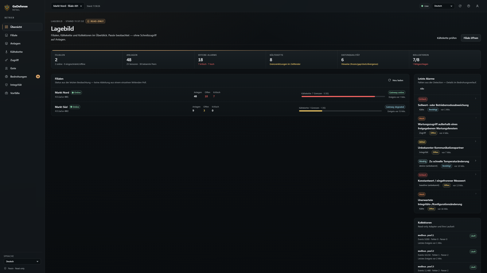
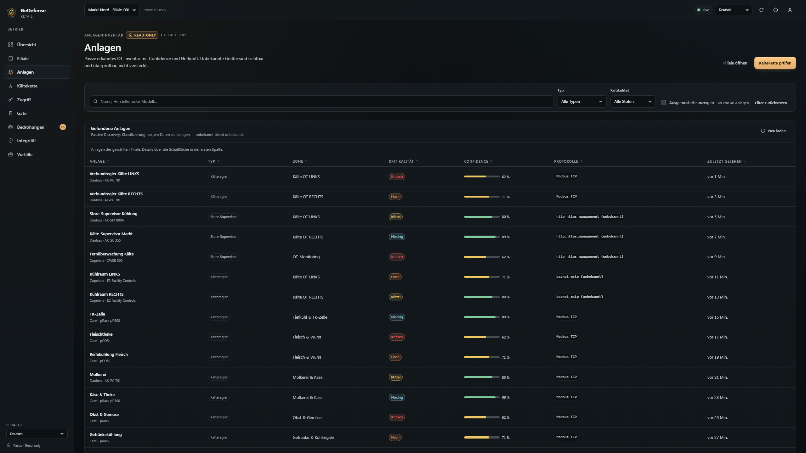
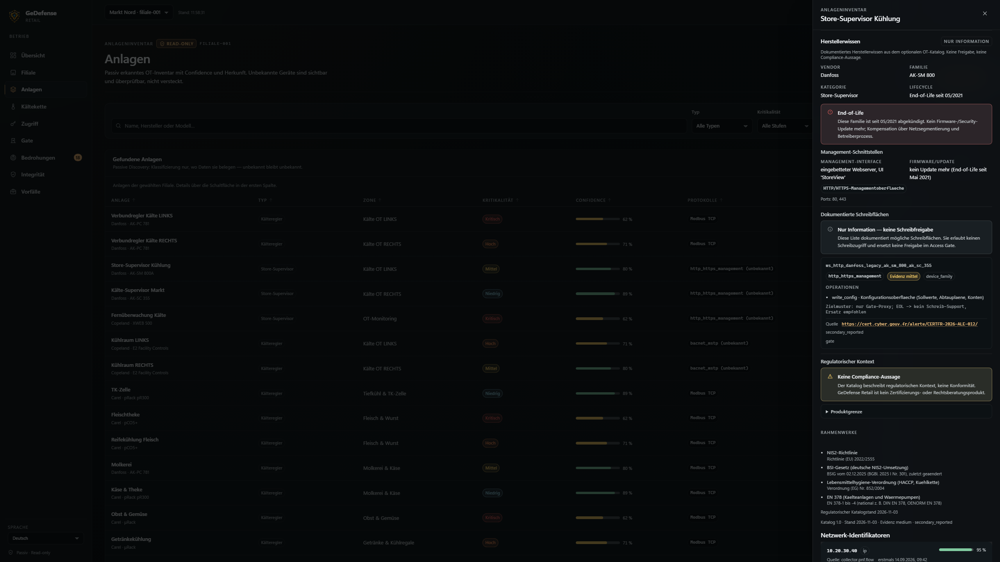
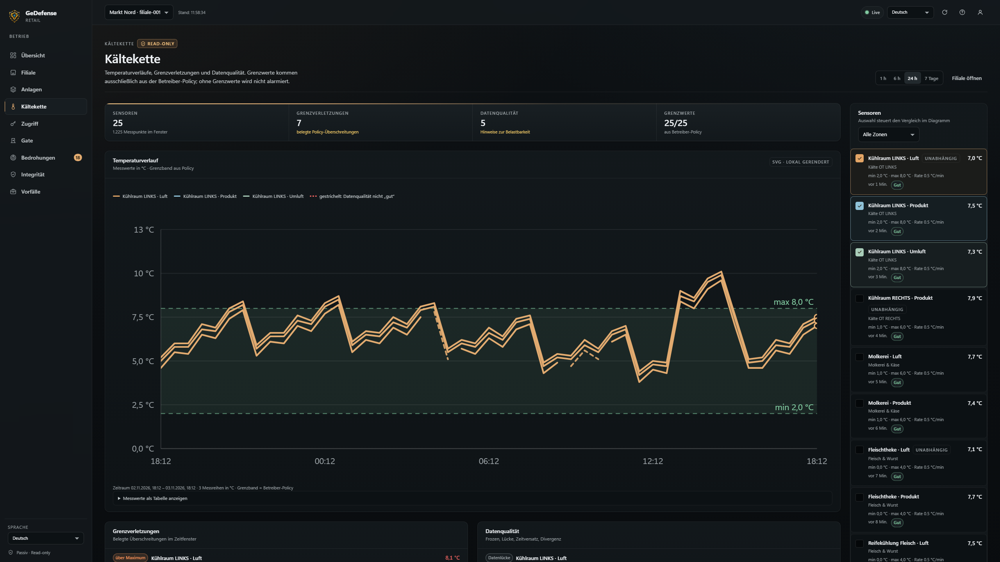
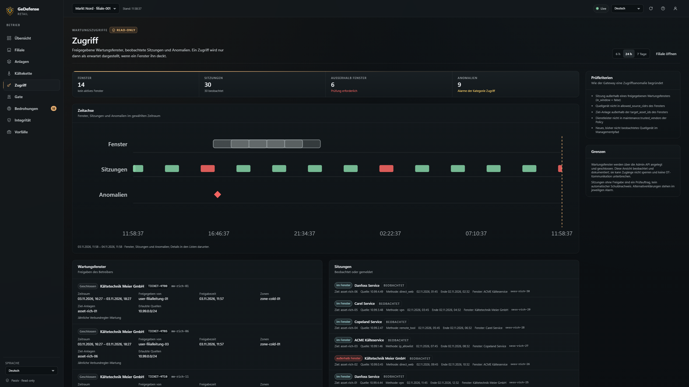
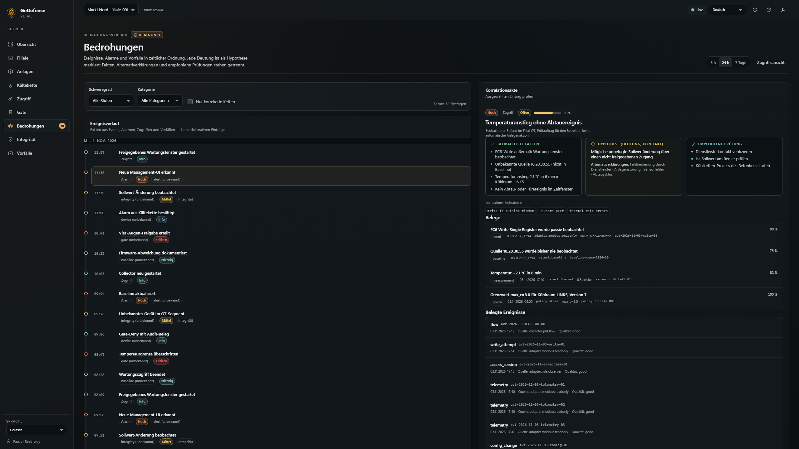
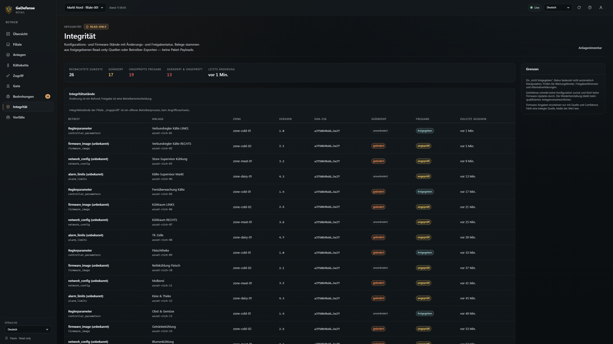
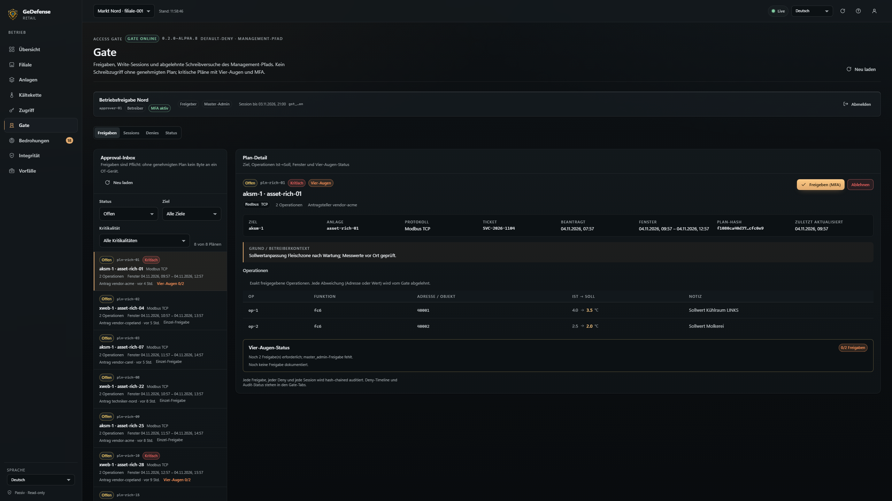
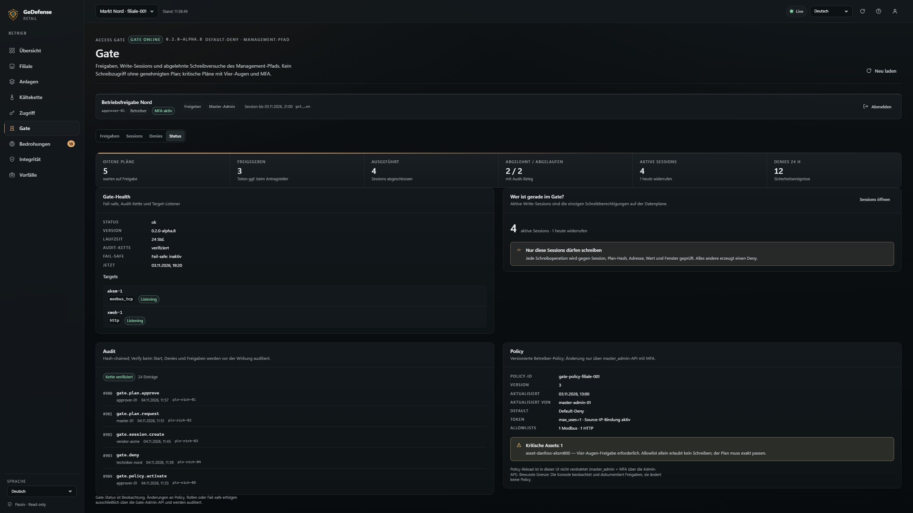
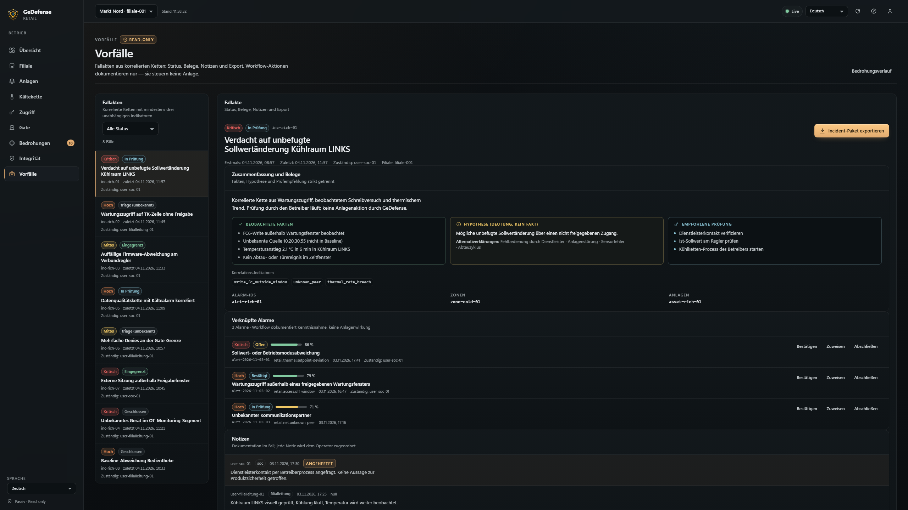

# Screenshots — GeDefense Retail Dashboard (Design-QA, Mock-Modus)

Diese Bilder wurden am 2026-11-03 mit **Chrome headless** gegen den **Mock-Modus**
(`internal/webui/web/mock/`, ausdrücklich als „DESIGN-QA · MOCK-DATEN" gekennzeichnet)
erzeugt. Sie zeigen Komposition, Hierarchie, Zustände und Responsive-Verhalten — **keine
echte Sicherheitslage** und keine echten Filialdaten.

Erzeugung: `python tests/visual_qa.py` (46 Bilder unter `var/visual-qa/`, inkl. Gate-Views,
Setup-Wizard, 8 Sprachen, Mobile und Zuständen). Reproduzierbar; Fixtures liegen unter
`src/retail/internal/webui/web/mock/fixtures/`.

| Datei | Ansicht | Viewport |
|---|---|---|
| `01-overview-desktop.png` | Retail Overview (Fleet, Alarme, Datenlage) | 1440×900 |
| `02-anlagen-desktop.png` | Asset Inventory (Filter, Confidence, Herkunft) | 1440×900 |
| `03-kaeltekkette-desktop.png` | Cold-Chain-Trend, Policy-Grenzband, Datenqualität | 1440×900 |
| `04-bedrohungen-desktop.png` | Threat Timeline + Korrelationsakte (Fakten/Hypothese/Prüfung) | 1440×900 |
| `05-zugriff-desktop.png` | Access Timeline (Wartungsfenster, Sitzungen, Anomalien) | 1440×900 |
| `06-integritaet-desktop.png` | Integrity Ledger | 1440×900 |
| `07-vorfaelle-desktop.png` | Incident Workspace (Workflow, Export) | 1440×900 |
| `08-empty-state-desktop.png` | Empty State mit Handlungsangebot | 1440×900 |
| `09-overview-mobile-500px.png` | Mobile Overview (Bottom-Nav, 2-spaltige KPI-Karten) | 500×844 |
| `10-overview-tablet.png` | Tablet Overview | 1024×768 |
| `11-gate-approval-inbox.png` | Access Gate - Approval-Inbox | 1440x900 |
| `12-gate-plan-detail.png` | Access Gate - Plan-Detail (Ist-Soll, Vier-Augen) | 1440x900 |
| `14-gate-sessions.png` | Access Gate - Sessions/Widerruf | 1440x900 |
| `15-gate-deny-timeline.png` | Access Gate - Deny-Timeline | 1440x900 |
| `16-gate-status.png` | Access Gate - Status/Fail-safe/Audit | 1440x900 |
| `17-gate-login.png` | Access Gate - Login | 1440x900 |
| `18-gate-mobile-500px.png` | Access Gate - Mobile | 500x844 |
| `setup-lang-en.png` … `setup-lang-ru.png` | Setup-Wizard Schritt 1 in 8 Sprachen (EN/DE/FR/IT/ES/JA/ZH/RU) | 1440×950 |
| `setup-step-site.png` | Setup - Filiale (Site, Zeitzone, Zonen) | 1440×950 |
| `setup-step-whitelist.png` | Setup - Whitelist (erkannte IP, Warnung, CIDRs) | 1440×950 |
| `setup-step-admin.png` | Setup - Admin-Zugang (Token einmalig) | 1440×950 |
| `setup-step-collectors.png` | Setup - Collectors | 1440×950 |
| `setup-step-summary.png` | Setup - Zusammenfassung | 1440×950 |
| `setup-complete.png` | Setup - Abschluss mit Restart-Hinweis je OS | 1440×1100 |
| `mobile-setup-language.png` | Setup - Sprache (Mobile) | 500×900 |
| `mobile-setup-whitelist.png` | Setup - Whitelist (Mobile) | 500×1000 |
| `notfound-sirdu.png` | 404-Seite mit Maskottchen Sirdu | 1440×900 |
| `desktop-vendor-panel.png` | Herstellerwissen im Asset-Inspector (Vendor/Family/Lifecycle/Write-Surfaces) | 1440×1200 |
| `desktop-vendor-panel-disabled.png` | Herstellerwissen degradiert (Katalog `enabled:false`) | 1440×1000 |
| `mobile-vendor-panel.png` | Herstellerwissen (Mobile) | 500×1000 |

**Hinweis zur Mobile-Breite:** Chrome unter Windows erzwingt bei `--window-size` eine
Mindest-Viewportbreite von ~500 CSS-Pixel; die 390-px-Emulation wurde per CDP
(`Emulation.setDeviceMetricsOverride`, `scrollWidth == innerWidth == 390`) vom UI-Owner
verifiziert und ist in `ui-design-spec.md` dokumentiert. Das Skript nutzt deshalb 500×844.
## 2K demo screenshots

Runtime-generated demo data for a large supermarket (48 assets, 25 cold-chain sensors, 14 maintenance windows, 28 alerts, 16 gate plans). **No production data.** All images are **2560 × 1440 px** and are embedded in every README.

<table>
  <tr>
    <td></td>
    <td></td>
  </tr>
  <tr>
    <td></td>
    <td></td>
  </tr>
  <tr>
    <td></td>
    <td></td>
  </tr>
  <tr>
    <td></td>
    <td></td>
  </tr>
  <tr>
    <td></td>
    <td></td>
  </tr>
</table>
